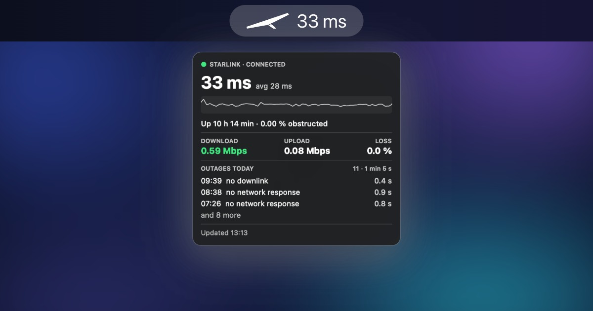

# StarlinkBar (v0.5.0)

A lightweight macOS menu bar app that shows your Starlink connection at a glance: live latency, packet loss, throughput, power use, obstruction, dish alerts and today's outages, read straight from your dish. Ships as a universal binary for Intel and Apple Silicon.



> Running an older version? From 0.4.0 on, StarlinkBar updates itself: right-click the menu bar icon → **Check for Updates…**. On 0.3.2 or earlier, re-download it once from [Gumroad](https://bereto.gumroad.com/l/starlinkbar).

**Menu bar:** the dish icon and your main reading, like `28 ms` (latency by default; or download, upload, packet loss or power use, or the icon alone). It says `offline` during an outage.

**Popup:**
- Connection state: Connected, Degraded or No internet, plus how long the dish has been up
- A callout when something's up with your service: a data limit or reduced speeds, a suspended account, or a dish update waiting to restart
- Your main reading big, with its 30 second average and a 15 minute sparkline (latency unless you pick another)
- The other four as columns: latency, download, upload, packet loss and the dish's power use in watts
- Obstruction and dish alerts in plain English ("Weaker signal than expected", "No Ethernet link"…)
- Today's outages with time, duration and cause

**Notifications:** when Starlink drops for more than 10 seconds, and again when it's back ("The outage lasted 42 s"). When the connection loses lots of packets without dropping (calls and video stutter). When the dish has an update and will restart for it ("around 3:00"). Optional heads-up for high latency.

**Updates:** checks once a day and asks before installing. Every update is signed and verified before it's applied.

**Not on Starlink?** The same card measures whatever network you're on (Wi‑Fi, Ethernet, hotspot): latency, loss, throughput and outages, with your last Starlink numbers at the bottom. The menu bar switches to an antenna so you always know which one you're looking at.

## How it works

Every Starlink dish answers a small local API at `192.168.100.1`, the same one the Starlink app uses. StarlinkBar asks it for status and history every couple of seconds and turns the numbers into something readable. It's read-only: it never sends commands to the dish (no reboots, no stow), and nothing leaves your network. No account, no server, no extra permissions beyond Local Network access.

When the dish stops answering, StarlinkBar checks whether the internet still works. If it does, you're on another network, not in a Starlink outage, so it measures that network instead and doesn't cry wolf.

The details (gRPC-web transport, field numbers, state rules) are in [docs/DESIGN.md](https://github.com/bereto-dev/starlink-monitor/blob/main/docs/DESIGN.md).

## Requirements

- macOS 13 or later
- Intel or Apple Silicon Mac
- A Starlink connection (the app works on other networks too, but there's no dish to read there)
- Xcode Command Line Tools (`xcode-select --install`) to build from source

## Download & run (no build required)

Get `StarlinkBar.app` from [Gumroad](https://bereto.gumroad.com/l/starlinkbar).

1. Download the app
2. Move it to your `/Applications` folder
3. Right-click → **Open** → **Open** (required once to bypass Gatekeeper on unsigned apps)
4. Allow **Local Network** access when macOS asks: that's how the app talks to the dish

## Build from source

```bash
git clone https://github.com/bereto-dev/starlink-monitor.git
cd starlink-monitor
menubar/StarlinkBar/build.sh --open   # universal build + launch
```

`build.sh --zip` packages `dist/StarlinkBar-<version>.zip` with `ditto`.

## Settings

Right-click the menu bar icon → **Settings…**

- Main reading: latency, download, upload, packet loss or power use. It's the big number and chart in the popup, and what the menu bar shows (or just the icon)
- Notifications for outages, high packet loss, dish updates and high latency
- Open at login
- Check for updates automatically (on by default)
- Data source: the dish directly (default) or the optional collector below

## Collector + Starlink Dashboard (optional)

For long-term history and a full-screen dashboard on any screen or browser in the house, there's a small Python collector (standard library only):

```bash
python3 collector/main.py        # or: collector/install-agent.sh to run it at login
```

Then open `http://<mac-ip>:8766/sl-dashboard/`. The dashboard is plain ES5, so it also runs on old smart-TV browsers. StarlinkBar can read from the collector instead of the dish (Settings › Data source).

API: `/api/now`, `/api/history?range=15m|1h|24h|7d`, `/api/outages?since=&min_s=`.

## Changelog

### 0.5.0 — Power use, your main reading and service alerts
- **Power use:** the dish's power draw in watts now sits in the popup next to download, upload and loss.
- **Pick your main reading:** in Settings, choose latency, download, upload, packet loss or power use. It becomes the big number and chart in the popup, and what the menu bar shows.
- **Packet loss alerts:** a notification when the connection loses lots of packets without dropping, the moments when calls and video stutter.
- **Update heads-up:** when the dish has an update ready, StarlinkBar tells you when it will restart (around 3:00 on most dishes), so the minute offline doesn't catch you by surprise.
- **Service callouts:** if Starlink limits your speed, you hit a data limit or the account is suspended, the popup says so in plain words above the main reading.
- A clear message if your network uses the same addresses as the dish (192.168.100.x), which keeps StarlinkBar from reaching it.

### 0.4.0 — Automatic updates
StarlinkBar now updates itself. Once a day it checks for a new version and, if there is one, shows you what's new with an Install and Relaunch button. You can also check any time from the right-click menu (Check for Updates…), and turn the daily check off in Settings. Updates are signed, so the app only installs versions that really come from me.

### 0.3.2 — New icon
A cleaner icon: a black dish on white, closer to the Starlink look. Downloads now live on Gumroad, and Check for Updates (right-click menu and About) takes you there.

### 0.3.1 — Roomier card
The popup is a bit wider so the numbers and the outage list breathe, and the refresh button is gone (the card already updates every couple of seconds). Refresh Now (⌘R) is still in the right-click menu.

### 0.3.0 — Works on any network
When you're not on Starlink, StarlinkBar now measures the network you're on: latency, loss, download, upload, time connected and today's outages, in the same card. The menu bar shows an antenna instead of the dish. Every dish alert also has a real name now, so you'll see "Weaker signal than expected" instead of "alert_17".

### 0.2.0 — New look
The popup was rebuilt to match my other menu bar apps: a dark card with a hand-drawn sparkline, a right-click menu, and proper Settings and About windows.

### 0.1.x — First versions
Reads the dish directly with no server needed, warns you about outages and when they end, and tells you when you're online through another network instead of showing a false outage.

## Origin

I wanted to know at a glance whether my Starlink was fine, without picking up my phone to open the Starlink app. Now it's one look at the menu bar.

Not affiliated with SpaceX or Starlink.

## License

[MIT](LICENSE)
